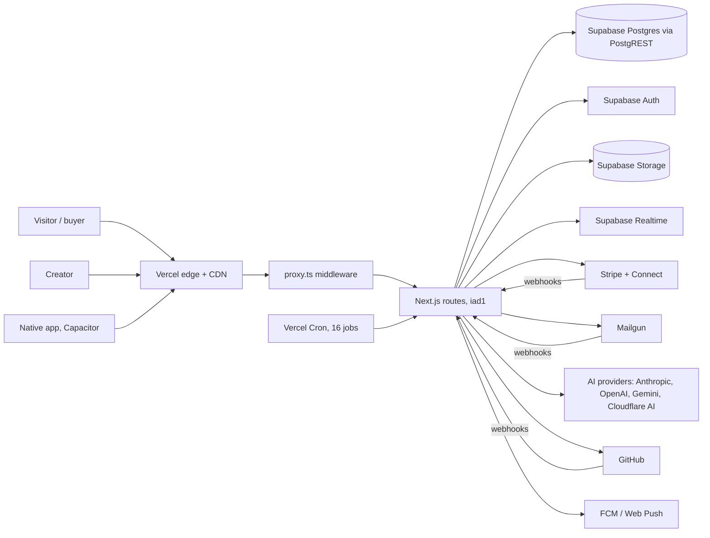

# Storelib architecture (reliability view)

What runs where, what each part depends on, and how far a failure spreads.
Written from the code at `10e69cf32` (branch `claude/reliability-engineering`)
and the five area audits. Findings are in [AUDIT.md](AUDIT.md).

## 1. Platform in one paragraph

One Next.js 16 (app router) application deployed on Vercel in a single
region (`iad1`, `vercel.json`). It serves every product from the same
deployment. Data lives in one Supabase project: Postgres with RLS, PostgREST,
Auth, Storage and Realtime. Payments go through Stripe, with Connect
destination charges for creator sales. Email goes out through Mailgun.
Background work runs as 16 Vercel cron jobs plus `after()` work inside
requests. There is no separate queue service, no separate worker fleet and no
second region.



## 2. Products and where they live

| Product | Address | Entry in code | Data path | Caching |
| --- | --- | --- | --- | --- |
| OnePages (link in bio) | `storelib.me/<name>` (also old `/l/<slug>` addresses, 308 to storelib.me) | `proxy.ts` asks `onePageRoute` (`lib/onepage/host-route.ts`), rewrites to `app/(marketing)/l/[slug]` | `lib/onepage/published-page.ts` `resolveOnePage` → `lib/onepage/address-lookup.ts` | `heldRead` (`unstable_cache`, 60s, tagged) |
| Creator Pages (storefront) | `storelib.com/<handle>` | `app/(marketing)/[sellername]` → `u/[username]` | `lib/commerce/creator-page-data.ts`, `lib/security/public-rows.ts` | dynamic |
| Published Websites: theme sites | `<name>.storelib.com`, custom domains | `proxy.ts` host routing → `/w/<name>` (native theme, ISR 60s) or `/api/site-theme/site/<name>/…` (imported Shopify theme, dynamic) | `lib/website-builder/published-site.ts`, `compat-site.ts` through `siteRead` (4s attempt, 7s budget, then throw) | `unstable_cache` tags, per-instance last-good copy, compat stranger hold |
| Published Websites: AI sites | `<slug>.storelib.com` | `proxy.ts` `hasLiveAiSite` → `app/(sites)/site/[slug]/[[...path]]` | `site_deployments.is_live` → Storage object | HTML `s-maxage=10, swr=30`; assets immutable |
| AI Website Builder | `storelib.com/website-builder/editor/[installId]`, AI sites editor | `app/api/website-builder/themes/[installId]/*`, `app/api/sites/[siteId]/*` | Postgres `store_theme_*`, `sites`, `site_deployments`; AI providers; GitHub; Chromium covers | none (editor) |
| Communities | `storelib.com/community/<slug>` | `app/api/community/[communityId]/**` (~100 routes), `app/api/app/community/[id]/**` | service-role client, access by `requireMember` in code | `no-store` for private content |
| Commerce | checkout pages, `/api/checkout/*`, `/api/stripe/*` | `stripe-session`, `confirm-with-pm`, `confirm-payment`, cart, site basket, physical, memberships | Stripe PaymentIntents and Checkout Sessions; `lib/checkout/fulfil-payment.ts`; ledger RPCs | none |
| Creator Dashboard | `storelib.com/app/*` | `app/app/layout.tsx` + pages | anon SSR client (layout, Products) and service-role client filtered by creator id (Home, Payouts, Customers, Orders) | per-request memo (`lib/auth/request-scope.ts`), some `unstable_cache` |

## 3. Shared systems

| System | Where | Notes |
| --- | --- | --- |
| Email | `lib/mail.ts` → `lib/mailgun.ts` | Mailgun only in code (no Resend calls found). 15s per attempt, bounded 429 retries, overall budget. Inbound webhooks HMAC-checked, 5 minute replay window, deduped by event id. |
| Notifications and push | `lib/notify/*`, `lib/push/sender.ts` | Outbox → jobs with `FOR UPDATE SKIP LOCKED` and a lease. FCM via firebase-admin, Web Push via `web-push`. |
| Integrations | `lib/integrations/marketing/http.ts`, OnePage integrations, analytics destinations, `lib/github-sync/github.ts`, translation (`lib/markets/*`) | Each has a timeout. GitHub has a breaker. Marketing jobs keyed by idempotency key. |
| Crons | `vercel.json`, `app/api/cron/*` | All behind `requireBearerSecret("CRON_SECRET")`, wrapped in `recordCronRun` (lease in `cron_runs`). Table below. |
| Analytics | `/api/track-view`, `/api/track-event` → `lib/analytics/collect-route.ts`; reports `/api/analytics/reports` | Collection answers 204 always; forwarding runs in `after()`. Reports read the `analytics_report` RPC over daily rollups plus raw events for today. |
| Uploads | `app/api/v2/upload/{prepare,complete,scan,bundle,server-upload,cancel}`, `app/api/storage/uploaded`, community `prepare`/`complete` | Signed upload URLs straight to Storage, then a server check. Buckets: `product-images` (public), `digital-products` (private). |
| Admin | `/admin`, `/api/admin/*` | `blog_admin` HMAC cookie (`lib/admin-session.ts`), checked by `lib/admin/gate.ts`. One shared identity. |
| Search | Postgres (`search_vector` on products, `pg_trgm` indexes on products and profiles) | No external search service. |
| Storage | Supabase Storage; video through Mux / Cloudflare Stream / Bunny (from the CSP list) | Downloads are 302s to 5 minute signed URLs. |
| Observability | `instrumentation.ts` `onRequestError`, `lib/observability/report.ts`, `error_events`, `cron_runs`, `/api/health`, `.github/workflows/uptime.yml` | Alert by email (`ALERT_EMAIL`) and webhook (`ALERT_WEBHOOK_URL`). See [release-safety.md](../operations/release-safety.md). |

## 4. Request flow

```mermaid
sequenceDiagram
  participant B as Browser
  participant X as proxy.ts
  participant R as Route / page
  participant DB as Supabase
  B->>X: request (host, path, cookies)
  X->>X: host routing: storelib.me OnePage? subdomain? custom domain?
  X->>DB: site facts (PROXY_DB, 5s cap, held answers per instance)
  X->>X: /api guard: refuse Sec-Fetch-Site same-site and published-site Origin on writes
  X->>DB: session: /app,/dashboard,/sell readVerifiedSession (JWKS getClaims, 3s, 1 retry); else readSessionPresence (getSession)
  X->>R: rewrite or pass through (redirect to /login only on "anonymous")
  R->>DB: reads through mediaFetch → deadlineFetch (auth 10s, read 20s, write 30s, rpc 60s)
  R-->>B: answer (or 503 + Retry-After when a site read failed)
```

1. **proxy.ts** (2,780 lines) runs on every matched request. In order: host
   routing (`storelib.me` OnePage rules, reserved subdomains in
   `EXCLUDED_SUBDOMAINS`, creator subdomains, custom domains via
   `resolveCustomDomain`), the published-site guard on `/api`
   (proxy.ts:1951-1976), then the session. Session cookies are host-only.
2. **Host routing** for sites picks one of: native theme (`/w/<name>`),
   imported theme (`/api/site-theme/site/<name>`), AI site
   (`app/(sites)/site/<slug>`), or the creator page. The answers ("has a live
   AI site", "has a compat site") are read from the database with a 5s cap and
   held per instance. Custom domains fall back to a 503 page when nothing is
   held; subdomains fall back to "no" (finding SITE-8).
3. **Supabase clients**, all built with `global.fetch = mediaFetch`
   (`lib/storage/media-url.ts`), which wraps `deadlineFetch`
   (`lib/net/deadline.ts`):
   - `lib/supabase/server.ts`: anon key plus the cookie session, RLS applies.
   - `lib/supabase/admin.ts`: service role, `server-only`, bypasses RLS;
     callers filter by the caller's own creator id.
   - `lib/supabase/public-read.ts`: anon singleton without cookies, for
     cacheable public reads.
   - `lib/supabase/client.ts`: browser singleton; Capacitor keeps the session
     in Preferences with a cookie mirror.
   - About ten modules still build a raw client without the wrapper
     (finding DB-1).
4. **Deadlines.** `deadlineFetch` aborts each Supabase request by kind: auth
   10s, read 20s, write 30s, rpc 60s, storage read 30s, storage write 120s
   (server only), functions 60s. Reads (GET/HEAD) are retried at most twice on
   a network error, 429, 502, 503 or 504, within the deadline. Writes are
   never retried. PostgREST's PGRST002 schema-cache 503 is retried up to 3
   times by `mediaFetch`. Public site reads add a tighter layer: `siteRead`
   gives each attempt 4s and the whole read 7s, so the production log line
   "no answer in 3000ms" is the second attempt after a 4s first (about 7s
   in total).
5. **Stripe.** One client (`lib/stripe.ts`) with 20s per attempt, 2 retries
   with capped backoff and jitter, and a per-instance circuit breaker
   (`lib/stripe/resilience.ts`: opens after 5 unanswered calls, 10s cooldown
   doubling to 60s, answers as a non-retryable 503).

## 5. Data stores

| Store | Holds | Notes |
| --- | --- | --- |
| Supabase Postgres | everything: profiles, creators, products, orders, ledger, subscriptions, sites, communities, analytics events and rollups, jobs, cron runs, error events | One project. PostgREST statement timeout for API roles (the code comment in `deadline.ts` says 8s for `authenticated`; exact project values UNPROVEN). Connection pool shared by all. |
| Supabase Storage | product files, images, site assets, AI site deployments, community files | `product-images` public; `digital-products` private (no bucket size limit set in repo SQL). |
| Next data cache / ISR | site data, OnePage reads, store currency | Per deployment; dropped on rollback. |
| Per-instance memory | last-good site copies, proxy held answers, Stripe breaker state, analytics answer cache (15s), JWKS (10 min) | Lost on every cold start and not shared between instances. |
| Stripe | payments, subscriptions, Connect accounts, payouts | Source of truth for money; the app mirrors it (`subscriptions`, `invoices`, `seller_ledger`, `stripe_webhook_events`). |
| Off-site backups | nightly encrypted DB dump and file copy | See [backups.md](../operations/backups.md). |

## 6. External dependencies

| Dependency | Used for | Timeout / guard in code | If it is down |
| --- | --- | --- | --- |
| Supabase Postgres / PostgREST | all data | deadlines above, read retries, `siteRead` | the main failure domain; see section 8 |
| Supabase Auth | sessions | 10s deadline, three-state auth, JWKS claims fallback | signed-in users stay signed in where the fallback is used (gaps SEC-3, SEC-8) |
| Supabase Storage | files, AI site deployments | 30s / 120s deadlines on shared clients | downloads and AI sites fail (SITE-2) |
| Stripe | checkout, billing, Connect | 20s, 2 retries, breaker | checkout fails cleanly; billing shows stored plan |
| Mailgun | all email | 15s per attempt, bounded retries, outbox | email delayed, outbox retries |
| Anthropic / OpenAI | builder agents | per-provider timeouts, per-tenant limits | AI endpoints answer 503; nothing else affected |
| Gemini / Cloudflare AI / others | translation | `AbortSignal.timeout`, provider rotation | original text shows |
| GitHub | builder sync | 25s, 4 attempts, breaker | sync pauses; publish unaffected |
| FCM / Web Push | push | FCM defaults; Web Push has no timeout (SHR-7) | pushes delayed |
| Chromium (cover shots) | builder covers | deadline | no new cover |

## 7. Cron jobs (from `vercel.json`)

All run in production only, need `CRON_SECRET`, and are recorded in
`cron_runs` with a lease that skips a run while an earlier one is younger than
its `maxDuration` plus 30s.

| Path | Schedule (UTC) | maxDuration | Does |
| --- | --- | --- | --- |
| `/api/cron/process-scheduled-emails` | `0 * * * *` hourly | 300 | campaign, automation and course emails, legacy queue |
| `/api/cron/fx-rates` | `35 15 * * 1-5` weekdays | none set | exchange rates |
| `/api/cron/release-holds` | `0 6 * * *` daily | none set | release ledger holds, "payout available" push |
| `/api/cron/rollup-daily` | `0 1 * * *` daily | 300 | analytics daily rollups, backfill |
| `/api/cron/purge-chat-attachments` | `20 3 * * *` daily | none set | old chat attachments |
| `/api/cron/storage-cleanup` | `40 3 * * *` daily | 300 | storage sweep, purge RPCs, community orphans |
| `/api/cron/strip-image-metadata` | `10 * * * *` hourly | 300 | strip EXIF from uploads |
| `/api/cron/notifications` | `25 * * * *` hourly | 300 | notification digests |
| `/api/cron/notify` | `*/5 * * * *` | 60 | notify outbox worker |
| `/api/cron/memberships` | `7,22,37,52 * * * *` | 60 | membership reminders, half-started cleanup |
| `/api/cron/physical` | every 10 min at :03 | 60 | stock holds, follow-up sweep, tracking, stale site payments |
| `/api/cron/community` | `*/5 * * * *` | 60 | community jobs, scheduled posts, deletions, automations |
| `/api/cron/translations` | `47 * * * *` hourly | 300 | translation safety sweep |
| `/api/cron/translation-jobs` | `*/5 * * * *` | 300 | continue translation jobs, changed stores |
| `/api/cron/warm-sites` | `*/5 * * * *` | 60 | self-fetch to warm site caches |
| `/api/cron/seo-index` | `*/10 * * * *` | 60 | IndexNow and SEO index status |

## 8. Failure domains

| Domain | Blast radius | Current isolation |
| --- | --- | --- |
| Supabase database slow or down | everything that reads data: sites, OnePages, checkout, dashboard, crons, webhooks | deadlines, read retries, last-good copies (per instance, theme sites only), CDN copies of static pages. This is the domain behind most production errors (see [AUDIT.md](AUDIT.md) baseline). |
| Supabase Auth slow | dashboard, builder, checkout for signed-in buyers | three-state auth, claims fallback; builder answers 503 instead of signing out |
| Single Vercel region (iad1) | the whole platform | none beyond Vercel's own; CDN keeps cached pages answering |
| Stripe | checkout, billing, payouts | breaker, stored plan shown, webhooks retried by Stripe |
| Mailgun | email | outbox and retries |
| AI providers | builder agents, translation | isolated: payments and publishing never call AI |
| GitHub | builder sync | isolated: publish never waits on GitHub |
| A bad deploy | everything | Vercel Instant Rollback ([rollback.md](../operations/rollback.md)) |
| One creator's bad publish | that site | per-site releases and backups |
| Per-instance memory | one instance | breaker and last-good copies are not shared; a cold instance starts with nothing held |
